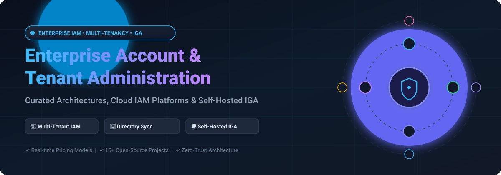

# 🏢 Awesome Enterprise Account &amp; Tenant Administration 🔐

### Curated Architectures, Cloud IAM Platforms, Directory Synchronization &amp; Self-Hosted IGA

  
  
  
  
  
  
  

  <b>A comprehensive directory of enterprise identity access management (IAM), multi-tenant administration, customer identity (CIAM), and identity governance &amp; administration (IGA) tools.</b>

---

## 📌 Executive Summary &amp; Overview

This repository provides an authoritative guide and benchmark to notable **SaaS platforms** and **open-source projects** for **Enterprise Account &amp; Tenant Administration**. Modern cloud-native businesses and distributed enterprises face increasing complexity managing identities, role-based access control (RBAC), fine-grained authorization (ABAC), directory synchronization (SCIM / LDAP), and cross-organization tenancy.

Whether your team is designing a multi-tenant B2B SaaS architecture, establishing automated employee onboarding/offboarding workflows, or eliminating per-seat SaaS costs with self-hosted identity governance platforms, this guide aggregates technical architectures, pricing transparency, and open-source alternatives.

---

## 📑 Table of Contents
- [📊 Sector Overview &amp; Market Dynamics](#-sector-overview--market-dynamics)
- [☁️ SaaS &amp; Hosted Enterprise Platforms](#️-saas--hosted-enterprise-platforms)
- [🔓 Open-Source GitHub Projects](#-open-source-github-projects)
- [🛠️ Multi-Tenancy Architecture Patterns](#️-multi-tenancy-architecture-patterns)
- [🤝 How to Contribute](#-how-to-contribute)
- [⭐ Star History](#-star-history)
- [💖 Support &amp; Sponsorship](#-support--sponsorship)
- [⚖️ Disclaimer](#️-disclaimer)

---

## 📊 Sector Overview &amp; Market Dynamics

The global **Identity and Access Management (IAM)** and **Identity Governance and Administration (IGA)** market represents one of the most critical segments in enterprise cybersecurity:

- 📈 **Market Size &amp; Growth**: Valued at approximately **$24.3 billion to $25.6 billion in 2026** (up from ~$20.5B in 2025), the IAM sector is projected to expand at a compound annual growth rate (CAGR) of **~15%**, exceeding **$45 billion by 2031**.
- 🧩 **Market Fragmentation**: The sector is **moderately fragmented**. While core cloud workforce single sign-on (SSO) and primary directories experience strong hyperscaler concentration (e.g., Microsoft Entra ID), specialized domains such as Customer IAM (CIAM), Privileged Access Management (PAM), non-human machine identity governance, and self-hosted open-source IDPs feature vibrant multi-vendor competition.
- 🤖 **Key Trends**: The rapid emergence of **Agentic AI** and non-human workload identities is accelerating the migration from coarse-grained perimeter security to dynamic, policy-as-code Zero Trust architectures and automated lifecycle synchronization.

---

## ☁️ SaaS &amp; Hosted Enterprise Platforms

The table below catalogs premier commercial SaaS solutions for enterprise account and tenant administration, sorted descending by organization size / enterprise scale.

| Product | Company Size (Market Cap / Revenue) | Key Features &amp; Architecture | Pricing (Starting Tier) | Free Tier / Trial Limits |
|---|---|---|---|---|
| **[Microsoft Entra ID](https://www.microsoft.com/en-us/security/business/identity-access/microsoft-entra-id)** | ~$3.1T Market Cap / ~$245B Ann. Rev | Cloud IAM suite providing multi-tenant administration, conditional access policies, Passkey/FIDO2 MFA, and hybrid directory sync via Cloud Sync or Connect Sync. | Entra ID P1: **$6.00/user/month** (annual commitment); P2: **$9.00/user/month** | **Free edition**: Basic directory and security defaults included with Azure/M365 accounts (unlimited users for basic core SSO and directory sync) |
| **[Oracle Cloud Infrastructure IAM](https://www.oracle.com/cloud/)** | ~$480B Market Cap / ~$53B Ann. Rev | Cloud IAM with compartments, policy hierarchies, identity domains, and cross-cloud identity federation. | Basic OCI IAM: **$0.00/month** (Included); OCI IAM Premium: **$3.20/user/month** | **Always Free tier**: Unlimited users for baseline tenancy administration; includes $300 cloud credits valid for 30 days |
| **[SAP Cloud Identity Services](https://www.sap.com/)** | ~$280B Market Cap / ~$34B Ann. Rev | Centralized authentication and identity provisioning (IAS/IPS) across SAP BTP and hybrid enterprise enterprise resource planning (ERP) systems. | Bundled with SAP BTP subscriptions; unbundled test/dev tenants starting at **~$0.20/user/month** or base service packs | **SAP BTP Free Trial**: 90-day trial capped at 1 trial tenant and a maximum of 50 users (on-premise Cloud Connector disabled in trial) |
| **[ServiceNow System Administration](https://www.servicenow.com/)** | ~$215B Market Cap / ~$11B Ann. Rev | Centralized enterprise platform administration with tenant configuration, RBAC, domain separation, and automated audit logging. | ITSM Foundation tier starts at **~$70.00/fulfiller user/month** (annual enterprise contract) | **Personal Developer Instance (PDI)**: Free indefinite access with full `admin` rights; instance sleeps and reclaims after 10 consecutive days of inactivity |
| **[Workday Tenant Management](https://www.workday.com/)** | ~$68B Market Cap / ~$8.4B Ann. Rev | Human capital management (HCM) and enterprise tenant administration using full service equivalent (FSE) worker accounting. | Core HCM starting at **~$8.00/employee/month** ($96/employee/year billed annually with multi-year contract) | **30-day free trial** available specifically for Workday Adaptive Planning; 0-day free trial for core HCM/Financials |
| **[CyberArk Identity](https://www.cyberark.com/)** | ~$17B Market Cap / ~$1.0B Ann. Rev | Workforce identity security platform providing unified single sign-on, adaptive multi-factor authentication, and automated account lifecycle governance. | Workforce Identity starting at **~$5.00/user/month** (subject to annual contract minimums) | **14-day free trial**: Fully functional evaluation sandbox tenant for up to 50 users |
| **[Okta](https://www.okta.com/)** | ~$14B Market Cap / ~$2.6B Ann. Rev | Cloud-native workforce and customer identity platform with multi-tenant organization management and Okta Universal Directory. | Workforce Starter: **$6.00/user/month** (annual contract); Single Sign-On: **$2.00/user/month** | **30-day free trial** for Workforce Identity Cloud with full features; Developer Edition free up to 7,500 monthly active users |
| **[Ping Identity](https://www.pingidentity.com/)** | ~$6.5B Valuation (Thoma Bravo) / ~$350M+ Ann. Rev | Enterprise IAM with identity governance, lifecycle orchestration, and high-scale directory synchronization. | PingOne Workforce starting at **$3.00/user/month** (minimum 5,000 user contract commitment) | **30-day free trial**: PingOne trial tenant with complete access to SSO and MFA configurations |

---

## 🔓 Open-Source GitHub Projects

Self-hosted identity and access management projects allow organizations to maintain strict data sovereignty, comply with GDPR/HIPAA regulations, and eliminate compounding per-seat SaaS costs. 

The projects below are sorted descending by GitHub stargazers count:

| Project | Stars_Badge | Architecture &amp; Capabilities | Primary Use Case |
|---|---|---|---|
| **[Keycloak](https://github.com/keycloak/keycloak)** |  | **Java/Quarkus (Apache-2.0)**. The industry-standard open-source IAM. Realms serve as the foundational isolation boundary; supports OIDC, OAuth 2.0, SAML 2.0, LDAP federation, and SCIM 2.0. | Battle-tested realm-per-tenant isolation for enterprise workforce and customer authentication. |
| **[Authelia](https://github.com/authelia/authelia)** |  | **Go (Apache-2.0)**. Lightweight authentication and authorization server acting as a companion to reverse proxies (Nginx, Traefik, Envoy, Caddy). Supports TOTP, WebAuthn/Passkeys, and Duo push. | Protecting self-hosted enterprise portals and internal administrative endpoints with multi-factor authentication. |
| **[authentik](https://github.com/goauthentik/authentik)** |  | **Python/Go (GPL-3.0)**. Highly customizable IdP with flexible stage flows, integrated LDAP outpost servers, RADIUS support, and automated user synchronization. | Modern all-in-one identity provider with built-in multi-tenancy and protocol translation. |
| **[Ory Hydra](https://github.com/ory/hydra)** |  | **Go (Apache-2.0)**. Hardened OpenID Connect Certified™ and OAuth 2.0 Authorization Server. Headless architecture connects to any custom user repository without altering database schemas. | High-throughput, headless authorization and federation backend for multi-tenant microservices. |
| **[ZITADEL](https://github.com/zitadel/zitadel)** |  | **Go/TypeScript (AGPL-3.0)**. Event-sourced IAM with strict tenant hierarchy: Systems → Organizations → Projects. Every modification produces an immutable event stream. | Complete audit trail compliance and native multi-organization B2B SaaS tenancy. |
| **[Casdoor](https://github.com/casdoor/casdoor)** |  | **Go (Apache-2.0)**. UI-first IAM featuring built-in LDAP and RADIUS servers, 70+ social/enterprise identity providers, and native Model Context Protocol (MCP) server support for AI agents. | Turnkey identity and single sign-on with legacy protocol backward compatibility and AI agent readiness. |
| **[Ory Kratos](https://github.com/ory/kratos)** |  | **Go (Apache-2.0)**. API-first headless identity and user management system providing registration, recovery, verification, WebAuthn, and multi-factor authentication flows. | Headless, custom-branded account registration and user credential lifecycle management. |
| **[FreeIPA](https://github.com/freeipa/freeipa)** |  | **C/Python (GPL-3.0)**. Integrated domain management combining 389 Directory Server (LDAP), MIT Kerberos, Dogtag Certificate System, NTP, and DNS. | Centralized Linux/UNIX domain administration and cross-forest Active Directory trust. |
| **[Tesseral](https://github.com/tesseral-labs/tesseral)** |  | **TypeScript/Go (Apache-2.0 / Commercial)**. Auth infrastructure designed for B2B multi-tenancy with customer-managed self-service SSO configuration pages and automated SCIM directory sync. | B2B SaaS startups seeking turnkey enterprise SSO, SAML, and SCIM capabilities without custom coding. |
| **[OpenIdentityPlatform OpenAM](https://github.com/OpenIdentityPlatform/OpenAM)** |  | **Java (CDDL-1.0)**. Community continuation of Sun/ForgeRock OpenAM providing access management, entitlement enforcement, and web policy agents. | Enterprise-wide access control, policy evaluation, and legacy web application gateway integration. |
| **[WSO2 Identity Server](https://github.com/wso2/product-is)** |  | **Java (Apache-2.0)**. Comprehensive customer and workforce IAM with domain segregation, adaptive authentication scripting, and SCIM 2.0 provisioning. | High-volume federated identity management and complex adaptive authentication journeys. |
| **[Janssen Project](https://github.com/JanssenProject/jans)** |  | **Java/Python (Apache-2.0)**. High-performance Linux Foundation project originating from Gluu Server, engineered for OAuth 2.0, FAPI, and high concurrency. | Mission-critical financial-grade API authentication and high-throughput corporate identity federation. |
| **[midPoint](https://github.com/Evolveum/midpoint)** |  | **Java (Apache-2.0 + EUPL)**. The most comprehensive open-source Identity Governance and Administration (IGA) platform, featuring periodic access reviews, certification campaigns, and role catalogs. | Enterprise-wide access certification, Segregation of Duties (SoD), and automated account provisioning. |
| **[Apache Syncope](https://github.com/apache/syncope)** |  | **Java (Apache-2.0)**. Open-source system for identity provisioning, access governance, and bi-directional directory synchronization. | Managing user lifecycles, automated role assignment, and multi-directory synchronization. |
| **[LSC (LDAP Synchronization Connector)](https://github.com/lsc-project/lsc)** |  | **Java (BSD-3-Clause)**. Synchronizes identity data across heterogeneous sources (RDBMS, LDAP, flat files) and destination directories like Active Directory or OpenLDAP. | Continuous or batch directory synchronization and Active Directory account attribute orchestration. |

---

## 🛠️ Multi-Tenancy Architecture Patterns

When designing multi-tenant account administration systems, three primary isolation patterns predominate:

1. 🏰 **Database / Infrastructure Isolation (Silo Pattern)**:
   - *Architecture*: Dedicated database and compute per tenant.
   - *Pros*: Maximum compliance, guaranteed data isolation, customized backup cadences.
   - *Cons*: Highest infrastructure cost, complex maintenance lifecycle across thousands of tenants.
2. 🗂️ **Schema / Realm Isolation (Bridge Pattern)**:
   - *Architecture*: Shared cluster with logical boundary separation (e.g., Keycloak realms, Postgres schemas).
   - *Pros*: Strong operational balance, independent configuration policies and user stores per tenant.
   - *Cons*: Schema migration complexity, memory overhead scaling linearly with realm counts.
3. 🏷️ **Row-Level / Tenant-ID Isolation (Pool Pattern)**:
   - *Architecture*: Shared database and tables partitioned with mandatory `tenant_id` foreign keys and Row-Level Security (RLS).
   - *Pros*: Most cost-effective, frictionless tenant onboarding, minimal operational overhead.
   - *Cons*: Requires rigorous authorization guards (e.g., OPA / SpiceDB) to prevent cross-tenant data leaks.

---

## 🤝 How to Contribute

We welcome community contributions! Please help us maintain accurate and comprehensive information:

1. 🍴 Fork this repository.
2. 🌿 Create a feature branch (`git checkout -b feature/new-identity-tool`).
3. 📝 Update or add entries to `README.md` adhering to the table format (include specific starting prices, exact trial conditions, and GitHub Stars_Badges).
4. 🚀 Push changes and submit a clean Pull Request with a brief justification.

---

## ⭐ Star History

---

## 💖 Support &amp; Sponsorship

If this curated repository saved your team time or helped streamline your enterprise identity and tenant architecture decisions, please consider supporting the project:

- ⭐ **Star this repository** to help other developers and architects discover it.
- 🍴 **Fork and share** with colleagues in your DevOps and security communities.
- ☕ **Buy me a coffee &amp; sponsor future open-source research**:  
  👉 **[Support on GitHub Sponsors](https://github.com/sponsors/ishandutta2007)**

Your support directly funds continuous research, real-time pricing verifications, and architectural benchmarking!

---

## ⚖️ Disclaimer

- This repository is a **community-curated index** created solely for educational and architectural reference; it does not constitute a formal commercial endorsement.
- Enterprise account and tenant administration platforms manage privileged credentials, authorization policies, and sensitive user data. Always enforce multi-factor authentication, least-privilege principles, and compliance with relevant legal standards (e.g., GDPR, SOC 2 Type II, HIPAA).
- Pricing data and trial specifications reflect publicly available enterprise metrics as of **March 2026** and are subject to change by respective vendors.

---

  Maintained with ❤️ by <a href="https://github.com/ishandutta2007">Ishan Dutta</a> and the global open-source identity engineering community.

